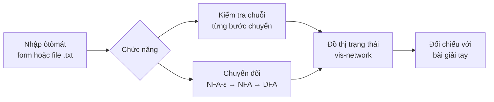
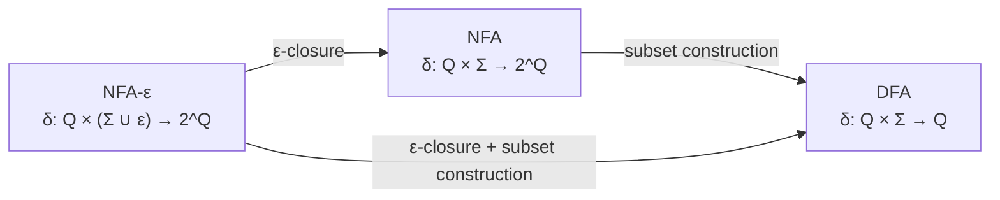
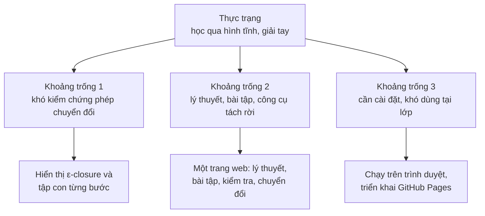
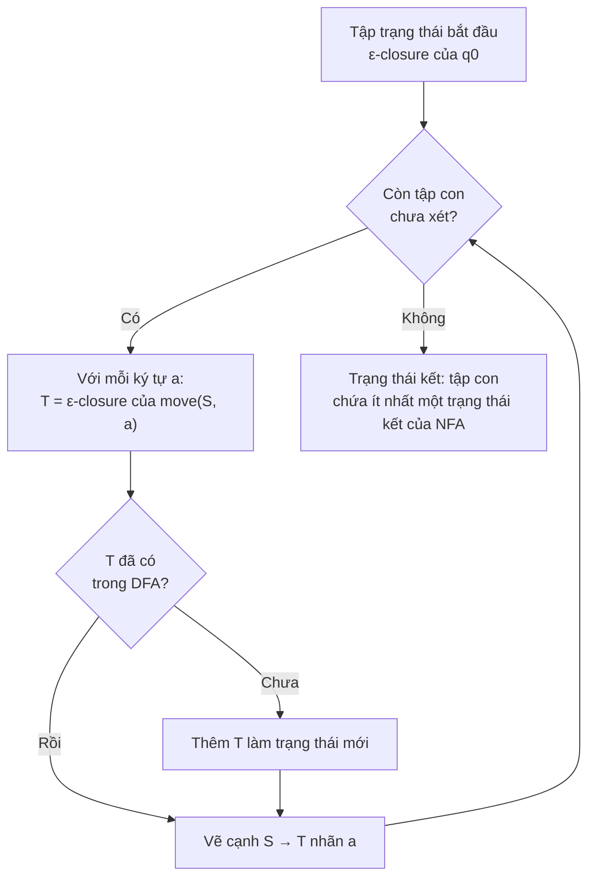
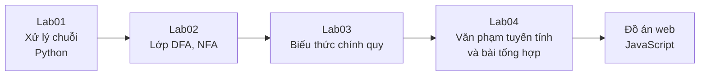
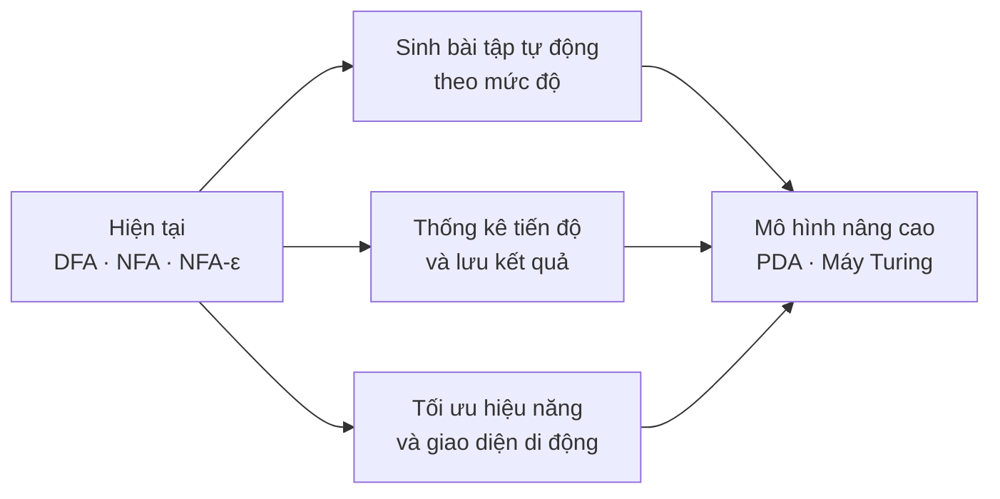

<div align="center">

# Website tương tác giải bài tập Automata

**CT121 – Tin học lý thuyết · Trường CNTT&TT, Đại học Cần Thơ · HKI 2025–2026**

Huỳnh Thanh Phong (B2207555 · STT 10) · GVHD: ThS. Phạm Xuân Hiền

[](https://huynhthanhphong231004it.github.io/Theoretical_Computer_Science_CT121/10_B2207555/Web/)
[](10_B2207555/THLT_Bao_Cao_final.pdf)

</div>

---

## 1. Tóm tắt

Ôtômát hữu hạn (DFA, NFA, NFA-ε) là nền tảng của ngôn ngữ hình thức và trình biên dịch, nhưng người học thường chỉ tiếp cận chúng qua hình vẽ tĩnh trên bảng và phép biến đổi làm tay, nơi một sai sót nhỏ trong tập trạng thái cũng làm hỏng toàn bộ lời giải. Đồ án xây dựng một **website tương tác** cho phép nhập ôtômát, chạy từng bước một chuỗi đầu vào trên đồ thị trạng thái, và thực hiện tự động các phép chuyển đổi *NFA → DFA*, *NFA-ε → NFA* và *NFA-ε → DFA*, qua đó người học đối chiếu lời giải của mình với kết quả của thuật toán ngay lập tức. Kho lưu trữ này gồm sản phẩm web, báo cáo đồ án và bốn bài thực hành Python làm nền cho phần cài đặt.

**Từ khóa:** DFA · NFA · NFA-ε · subset construction · ε-closure · trực quan hóa thuật toán



**Cấu trúc kho lưu trữ**

| Thư mục / tệp | Nội dung | Vai trò |
|---|---|---|
| `10_B2207555/Web/` | Website (HTML, CSS, JS thuần + vis-network) | Sản phẩm chính |
| `10_B2207555/THLT_Latex/` | Mã nguồn LaTeX và hình của báo cáo | Tài liệu |
| `Lab01` – `Lab04`, `Lap02` | Thực hành Python: chuỗi, DFA/NFA, regex, văn phạm | Nền tảng cài đặt |
| `BaoCaoTHLT.pdf`, `BaoCaoProject.pdf` | Báo cáo môn học và đồ án | Tài liệu |
| `Tài liệu ôn.pdf`, `BÀI TẬP TIN HỌC LÝ THUYẾT.docx` | Tài liệu ôn tập và bài tập | Tham khảo |

---

## 2. Lý thuyết ứng dụng

Ba mô hình DFA, NFA và NFA-ε có sức mạnh nhận dạng như nhau: cả ba đều chấp nhận đúng lớp ngôn ngữ chính quy. Sự khác biệt nằm ở hàm chuyển, nên cũng nằm ở độ khó khi người học phải hình dung chúng. Với DFA, mỗi cặp (trạng thái, ký tự) dẫn tới đúng một trạng thái; với NFA, nó dẫn tới *một tập* trạng thái; với NFA-ε, tập này còn mở rộng qua các cạnh không tiêu thụ ký tự. Chính bước nhảy từ "một trạng thái" sang "một tập trạng thái" là chỗ sinh viên vấp nhiều nhất khi học thuật toán *subset construction*.



**Khoảng trống nghiên cứu.** Các công trình về dạy học ôtômát đã chỉ ra rằng công cụ trực quan, tương tác giúp tăng mức độ hiểu và tham gia của sinh viên, điển hình là ứng dụng web mô phỏng ôtômát hữu hạn và hướng chuyển phần học lý thuyết ôtômát lên nền tảng số (xem [3], [4]). Tuy nhiên, phần lớn công cụ hướng tới *vẽ và mô phỏng* một ôtômát cho trước, trong khi điều sinh viên thực sự cần khi giải bài tập là *kiểm chứng phép biến đổi*: thấy rõ tập ε-closure của từng trạng thái, thấy từng tập con được sinh ra trong DFA và tại sao một chuỗi bị từ chối. Thêm vào đó, các công cụ này ít khi gắn lý thuyết, bài tập và công cụ vào cùng một nơi, và hiếm khi dùng được ngay trên trình duyệt mà không cần cài đặt. Đồ án nhắm vào đúng khoảng trống này: biến các thuật toán chuyển đổi, vốn là phần trừu tượng nhất của chương, thành thứ có thể quan sát từng bước.



**Từ thuật toán đến mô-đun.** Mỗi phép biến đổi lý thuyết được cài đặt thành một mô-đun JavaScript riêng, dùng chung một định dạng dữ liệu (trạng thái, bảng chữ cái, trạng thái đầu, trạng thái kết, bảng chuyển) để kết quả của mô-đun này làm đầu vào cho mô-đun kia.

| Cơ sở lý thuyết | Mô-đun | Trang |
|---|---|---|
| Chạy chuỗi trên DFA | `DFA.js` | `DFA.html` |
| Chạy chuỗi trên NFA (theo tập trạng thái hiện hành) | `NFA.js` | `NFA.html` |
| Chạy chuỗi trên NFA-ε (đóng bao ε tại mỗi bước) | `NFAe.js` | `NFAe.html` |
| Subset construction | `NFAtoDFA.js` | `NFADFA.html` |
| ε-closure rồi subset construction | `NFAe_to_DFA.js` | `NFAeNFADFA.html` |
| Tổng hợp định nghĩa và bài tập | — | `LyThuyet.html` |



Số trạng thái của DFA thu được có thể lên tới 2ⁿ so với NFA gồm n trạng thái, đây cũng là giới hạn hiệu năng chính của một công cụ chạy hoàn toàn trên trình duyệt.

Dữ liệu ôtômát nhập từ file `.txt` có dạng khóa–giá trị, mỗi cạnh chuyển là một dòng `nguồn, ký hiệu, đích`:

```text
states: q0, q1, q2
alphabet: a, b
start: q0
accept: q2
transitions:
q0, a, q1
q1, b, q2
```

Đồ thị dùng bảng màu cố định để người học nhận ra vai trò trạng thái ngay: **xanh lá** là trạng thái bắt đầu, **đỏ** là trạng thái kết, **xanh dương** là trạng thái còn lại.

**Lộ trình thực hành làm nền cho phần cài đặt**



---

## 3. Đóng góp và kết luận

Đồ án đóng góp một công cụ học tập đưa các phép chuyển đổi ôtômát từ dạng kết quả cuối sang dạng quá trình quan sát được, và gom lý thuyết, bài tập, kiểm tra chuỗi, chuyển đổi vào một trang web dùng ngay trên trình duyệt. Mỗi đóng góp dưới đây đáp lại một khoảng trống đã nêu ở phần 2.

| Khoảng trống | Đóng góp | Bằng chứng trong kho |
|---|---|---|
| Khó kiểm chứng phép chuyển đổi | Cài đặt subset construction và ε-closure có trực quan hóa trên đồ thị | `NFAtoDFA.js`, `NFAe_to_DFA.js` |
| Lý thuyết và công cụ tách rời | Trang lý thuyết, bài tập và công cụ chung một giao diện | `LyThuyet.html`, `index.html` |
| Khó dùng tại lớp | Chạy thuần phía trình duyệt, triển khai trên GitHub Pages | [Live Demo](https://huynhthanhphong231004it.github.io/Theoretical_Computer_Science_CT121/10_B2207555/Web/) |
| Thiếu nền tảng cài đặt | Chuỗi bài thực hành Python từ xử lý chuỗi đến văn phạm | `Lab01` – `Lab04` |

Hệ thống hiện còn một số giới hạn do báo cáo tự đánh giá: hiệu năng giảm với ôtômát lớn, chưa sinh bài tập tự động, chưa lưu tiến độ học và chưa tối ưu cho thiết bị di động. Các hướng mở rộng tương ứng được trình bày dưới đây.



**Kết luận.** Điểm mới của đồ án không nằm ở thuật toán, vốn là kiến thức kinh điển, mà ở cách đặt người học vào bên trong thuật toán: thấy tập ε-closure, thấy từng tập con được sinh ra và thấy chuỗi đi qua trạng thái nào. Với ôtômát cỡ bài tập trên lớp, cách làm này thay việc "tin vào lời giải tay" bằng việc "tự kiểm chứng được lời giải". Mở rộng sang PDA và máy Turing sẽ đưa công cụ phủ hết các mô hình của học phần CT121.

---

### Tài liệu tham khảo

1. M. Sipser, *Introduction to the Theory of Computation*, 3rd ed., Cengage Learning, 2012.
2. J. E. Hopcroft, R. Motwani, J. D. Ullman, *Automata Theory, Languages, and Computation*, 3rd ed., Pearson, 2007.
3. *A Web App for Teaching Finite State Automata*, 2024.
4. *Migrating teaching of automata theory to a digital platform*, 2024.

<sub>© 2025 Huỳnh Thanh Phong · Đại học Cần Thơ · Sản phẩm phục vụ học tập.</sub>
